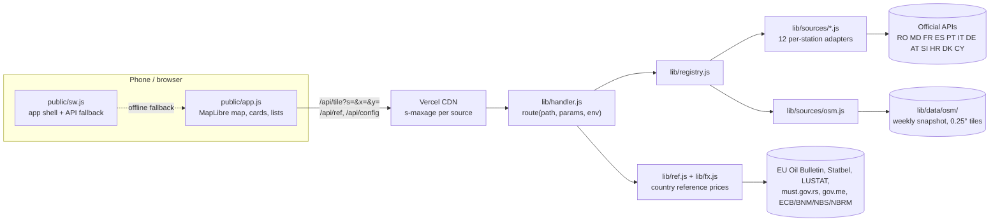

# GasFind

[](https://github.com/Andeaf/gasfind/actions/workflows/ci.yml)
[](https://gasfind-three.vercel.app)
[](LICENSE)

GasFind is a free, installable web app (PWA) that shows fuel stations across Europe on a map, with live prices read directly from official public sources.

It is built for drivers who cross borders and want one map instead of one app per country: no account, no ads, no paid APIs, no tracking. It runs in any phone browser and can be installed on the home screen on Android and iOS.

**Status:** live at https://gasfind-three.vercel.app and actively maintained. Per-station prices cover 12 countries; every other European country gets its stations from OpenStreetMap and, for EU members plus Belgium, Luxembourg, Serbia and Montenegro, an official country-level reference price. The user interface is currently Romanian-only (an English UI is on the roadmap). Code comments are in Romanian.

<!--
Screenshots: add the images to docs/screenshots/ and uncomment this block.
| Map with ranked prices | Station card | Cheapest nearby |
|---|---|---|
|  |  |  |
-->

## Features

- **Map with prices on every station.** The marker shows the price of the selected fuel (diesel, petrol 95, E10, 98+, LPG). Colours rank the stations currently in view: green is the cheapest, red the most expensive.
- **Station card** with all prices, the time of the last update, the distance from you and a one-tap **Navigate with Google Maps** button.
- **Cheapest nearby**: a ranked list of the stations in the visible area.
- **Country reference prices** (EU weekly average or the legal maximum price) shown, clearly labelled, for stations that have no price of their own.
- **Cross-border comparison**: prices in RON and MDL are converted with central-bank rates, so a Romanian and a Hungarian station can be compared on the same map.
- **Works offline**: a service worker caches the app shell and the last API responses; stale prices (older than 7 days) are drawn in grey.
- **Respects every source's rules**: rate limits are enforced on the server and mirrored in the client, attribution is shown in the Info sheet, and bulk sources are downloaded once and shared through the CDN.

## Data sources

### Per-station prices (live)

| Country | Official source | Coverage |
|---|---|---|
| Romania | Competition Council, *Monitorul Prețurilor* | Petrom, OMV, Rompetrol, Lukoil, MOL, Socar, Gazprom (reported daily). Independent stations appear without a price. |
| Moldova | ANRE, *e-Carburanți* | all stations, MDL, daily |
| France | prix-carburants.gouv.fr (Licence Ouverte 2.0) | all stations, refreshed every ~10 minutes |
| Spain | MITECO Geoportal | all stations, ~30 minutes |
| Portugal (mainland) | DGEG | all stations, every price change (non-commercial use only) |
| Italy | MIMIT, *Osservaprezzi* (IODL 2.0) | all stations, live self-service price |
| Germany | Tankerkönig (MTS-K data, CC BY 4.0) | all stations, live. Needs a free API key; one request per minute per key, so areas load progressively. |
| Austria | E-Control, *Spritpreisrechner* | only the ~5 cheapest stations per area, as Austrian law prescribes |
| Slovenia | goriva.si | all stations |
| Croatia | Ministry of Economy (mzoe-gor.hr) | all stations |
| Denmark | Public price APIs of OK, Shell, Q8/F24, OIL!, Circle K and INGO (mandatory under Danish law since 2026) | ~1,600 stations, live. Go'on and Uno-X need optional keys. |
| Cyprus | Ministry of Energy, Commerce and Industry price observatory (data.gov.cy, CC BY-SA 4.0) | all ~320 stations, live |
| Rest of Europe | OpenStreetMap (weekly snapshot, ODbL) | stations without a price; the card shows the country's reference price |

### Reference prices (per country, not per station)

| Country | Source | Kind | Refresh |
|---|---|---|---|
| All EU members | European Commission, Weekly Oil Bulletin (CC BY 4.0) | national average | weekly |
| Belgium | FPS Economy via Statbel be.STAT (CC BY 4.0) | legal maximum | daily |
| Luxembourg | Ministry of the Economy via STATEC/LUSTAT (CC0) | legal maximum | on every change |
| Serbia | Ministry of Internal and Foreign Trade (must.gov.rs) | legal maximum, RSD | weekly |
| Montenegro | Ministry of Energy and Mining (gov.me) | legal maximum | weekly |

Reference prices appear only in the card of a station without a price and in a small band under the fuel selector when the visible area is in a country without per-station data. They never influence the map colours or the cheapest list.

**No free source yet:** United Kingdom (Fuel Finder requires a GOV.UK One Login account and a UK IP address), Switzerland, Norway, North Macedonia, Albania. Greece publishes station prices only behind a reCAPTCHA that forbids automated access; Czechia publishes maximum prices only in hard-to-parse PDFs. These stay on the EU average where available.

## Tech stack

| Layer | Choice |
|---|---|
| Runtime | Node.js ≥ 20, plain ES modules, **zero runtime dependencies** |
| Frontend | Vanilla JavaScript (one module), MapLibre GL JS 6.11.2 (vendored), OpenFreeMap vector tiles, service worker (PWA) |
| Backend | Vercel serverless functions (region `fra1`) behind the Vercel CDN; the same handler runs locally through a 60-line Node server |
| Tests | Node's built-in test runner, 55 tests, no network access; optional Playwright smoke test against a mock server |
| Automation | GitHub Actions: CI on every push, weekly OpenStreetMap snapshot, weekly production health check |
| Dev dependencies | esbuild, maplibre-gl, topojson-client, world-atlas (only for the generator scripts) |

## Architecture



**One request path, two hosts.** The client calls four JSON endpoints: `/api/config`, `/api/tile`, `/api/detail` and `/api/ref`. The files in `api/` are six-line Vercel wrappers and `server.js` routes the same paths locally. All logic lives in `lib/handler.js`, which is platform-agnostic.

**Tiles are per source.** Each adapter declares its own tile size in degrees, sized to its API's radius and result limits, and a coverage list of bounding boxes. At zoom 10 and above the client computes which tiles of each enabled source cover the viewport and fetches them with a small concurrency limit. Priced sources are queued before OpenStreetMap, which may use at most two of the six request slots.

**Caching lives in the CDN.** Every tile response carries `s-maxage` equal to the source's refresh interval (10 minutes to 14 days) and `stale-while-revalidate` of twice that; the browser keeps it for at most 60 seconds. Partial responses get a short TTL and errors are never cached. The client re-requests any tile older than twice its TTL, which usually means it came from the service worker's offline fallback.

**Bulk national sources** (Denmark, Cyprus, Spain, Portugal and all reference prices) are downloaded once per function instance with an in-memory memo that deduplicates in-flight loads and serves a stale copy if the loader fails, then filtered by bounding box per tile.

**Normalised stations.** Every adapter returns stations through a single constructor that rounds coordinates, drops implausible prices per currency and converts source timestamps (usually local time without a zone) to UTC ISO strings.

**OpenStreetMap as the fallback layer.** Stations without a price are shown only in countries that lack a complete official source, with a point-in-polygon filter against Natural Earth borders. The data come from a weekly snapshot (one Overpass query per country, retries over three endpoints, a time budget, failed countries keep their previous data) committed by a GitHub Actions workflow. Live Overpass is used only for a country missing from the snapshot.

### Project layout

```
public/            the app: HTML, CSS, JS, vendored MapLibre, icons, service worker
api/               Vercel function wrappers: /api/config, /api/tile, /api/detail, /api/ref
lib/handler.js     the API logic (shared by Vercel and the local server)
lib/sources/*.js   one adapter per per-station price source (+ osm.js)
lib/ref/*.js       one adapter per reference-price source; lib/ref.js aggregates them
lib/fx.js          exchange rates (ECB, BNM, NBS, NBRM)
lib/http.js        fetch with timeout/retry/CA override, concurrency limiter, memo cache
lib/xlsx.js        dependency-free XLSX reader (EU Weekly Oil Bulletin)
lib/station.js     the normalised station schema
lib/data/          generated data: country polygons, French station names, Danish coordinates
lib/data/osm/      the weekly OpenStreetMap snapshot (generated, ODbL)
scripts/           data generators and the production health check
test/              tests with trimmed real responses as fixtures
.github/workflows/ CI, weekly OSM snapshot, weekly production check
server.js          local server
```

## Running locally

Prerequisites: Node.js 20 or newer. Nothing to install: the app has no runtime dependencies.

```bash
git clone https://github.com/Andeaf/gasfind.git
cd gasfind
node server.js                     # http://localhost:3000
```

- **Mock mode** (deterministic fake data, every source enabled, no network): `GASFIND_MOCK=1 node server.js` (on Windows: `set GASFIND_MOCK=1 && node server.js`).
- **API keys** are optional and only unlock extra sources (Germany, two Danish brands). Copy `.env.example` to `.env` and fill in what you have; the local server reads it. On Vercel, set them as environment variables.
- `PORT` overrides the port.

### Tests

```bash
npm test                                   # all tests, no network needed
node --test test/parsers.test.js           # one file
node --test --test-name-pattern="Cipru" test/parsers.test.js
```

Tests never touch the network: the handler tests swap the HTTP transport, and the parser tests run each adapter against trimmed real responses kept in `test/fixtures.js`. A headless-Chromium smoke test (`test/ui.mjs`, mobile viewport) runs against the mock server; Playwright is not a project dependency: point `PLAYWRIGHT_PATH` at an existing `playwright` package and `GLYPHS` at a `0-255.pbf` glyph file, then run `node test/ui.mjs`.

### Regenerating data files (optional, after `npm install`)

```bash
npm run build:vendor               # copy MapLibre GL into public/vendor
npm run build:countries            # country polygons from Natural Earth
node scripts/build-dk-sites.js     # Danish Q8/F24 and Circle K/INGO coordinates via DAWA (no deps)
node scripts/build-osm.js          # OpenStreetMap snapshot from Overpass (no deps; 30 min to hours)
node scripts/check-prod.js [url]   # the production health check (exit 1 on failure)
```

## Deployment

The app runs on Vercel's free Hobby plan. `vercel.json` sets the region, the 60-second function limit and includes the OSM snapshot in the tile function's bundle. A push to `main` deploys to production; `npx vercel --prod` does the same from the command line. Two scheduled workflows keep production healthy: the OSM snapshot is rebuilt and committed every Monday, and a production check requests one tile per source plus the reference prices and fails the run (and emails the owner) if a source is down or stale.

## Technical decisions worth discussing

- **Zero runtime dependencies**, including a small XLSX reader written for the EU Weekly Oil Bulletin, so cold starts stay fast and there is nothing to audit or update.
- **A tile grid per source instead of one global grid.** Each official API has a different maximum radius and result count; sizing the tile to the API keeps every request within limits and lets the CDN cache each tile for exactly as long as that source refreshes.
- **Cache behaviour measured, not assumed.** The CDN's stale-while-revalidate window, background refresh timing and deploy invalidation were measured on the real platform, and the client's re-request logic is built on those numbers.
- **A weekly OSM snapshot in the repository.** Overpass is slow and often overloaded, so a GitHub Actions job rebuilds the snapshot country by country, with retries and a time budget, and commits it; the runtime reads files and uses Overpass only as a fallback. The trade-off is repository growth, which is acceptable at the current size.
- **Cyprus as a single tile.** The observatory answers every request in 12 to 22 seconds whatever the filter, so the whole island is one tile: a single function downloads it and the CDN serves everyone else.
- **TLS done properly.** One source sends an incomplete certificate chain; the app appends the missing public intermediate certificate instead of disabling verification.
- **Rate limits mirrored on both sides.** Tankerkönig allows one request per minute per key; the server enforces it per instance and the client avoids sending requests it knows would be rejected.
- **Reference prices are a separate concept.** A country average is never mixed with station prices: it is shown only where a station has no price and never affects colours or rankings.
- **Tests on real responses.** Every adapter has a fixture trimmed from a real API response and a parser test, and the HTTP layer can be swapped so the full request path is tested without network.

## Known limitations

- Germany loads one area per minute (Tankerkönig's limit); OpenStreetMap stations fill the gap meanwhile.
- Austria publishes only the cheapest stations in each area.
- A newly mapped OpenStreetMap station can take up to a week to appear.
- Portugal's DGEG data may be used non-commercially only, which is why the app is free and will stay so.
- Prices are informative. Check at the pump.

## Roadmap

- **In progress:** English user interface.
- **Planned:** screenshots in this README; running the Go'on and Uno-X adapters with real keys (written, not yet verified live).
- **Blocked on access:** United Kingdom (Fuel Finder API needs a GOV.UK One Login account and a UK IP), Greece, Czechia, North Macedonia and Albania (no machine-readable official source found).

## Licence and attributions

The source code is **source-available** for reference and portfolio purposes; see [LICENSE](LICENSE).

- Map: OpenFreeMap, © OpenStreetMap contributors (ODbL)
- MapLibre GL JS: BSD-3-Clause
- Country polygons: Natural Earth (public domain)
- Stations without price and French station names: © OpenStreetMap contributors (ODbL 1.0); the snapshot in `lib/data/osm/` is a derived database under ODbL 1.0
- Danish station coordinates: DAWA, Danmarks Adressers Web API
- Per-station prices: Consiliul Concurenței, ANRE, Ministère de l'Économie (Licence Ouverte 2.0), MITECO, DGEG, MIMIT (IODL 2.0), Tankerkönig / MTS-K (CC BY 4.0), E-Control, goriva.si, Ministarstvo gospodarstva RH, OK / Shell (DCC Energi) / Q8 Danmark / OIL! / Circle K Danmark / INGO, Ministry of Energy, Commerce and Industry of Cyprus (CC BY-SA 4.0)
- Reference prices: European Commission Weekly Oil Bulletin (CC BY 4.0), FPS Economy / Statbel (CC BY 4.0), STATEC / data.public.lu (CC0), Ministarstvo unutrašnje i spoljne trgovine Republike Srbije, Ministarstvo energetike i rudarstva Crne Gore
- Exchange rates: European Central Bank, National Bank of Moldova, National Bank of Serbia, National Bank of the Republic of North Macedonia
